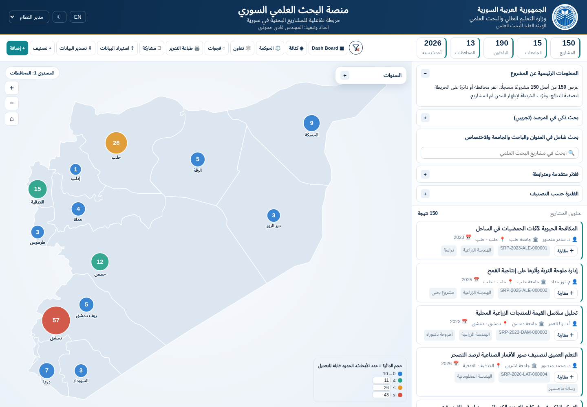
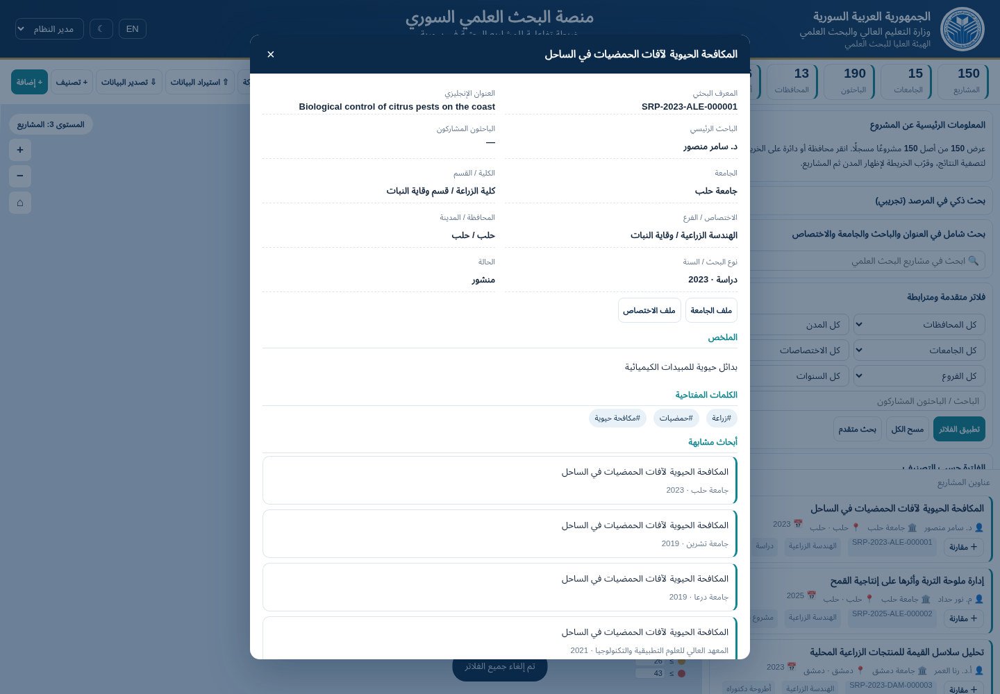
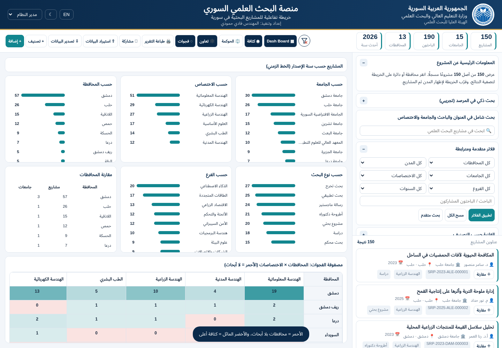
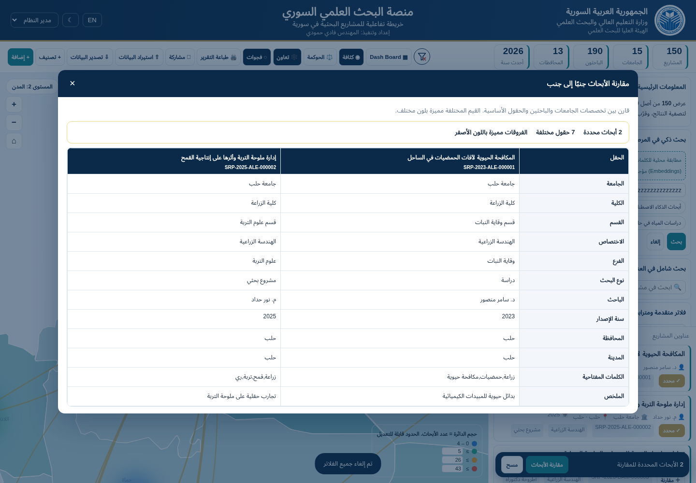
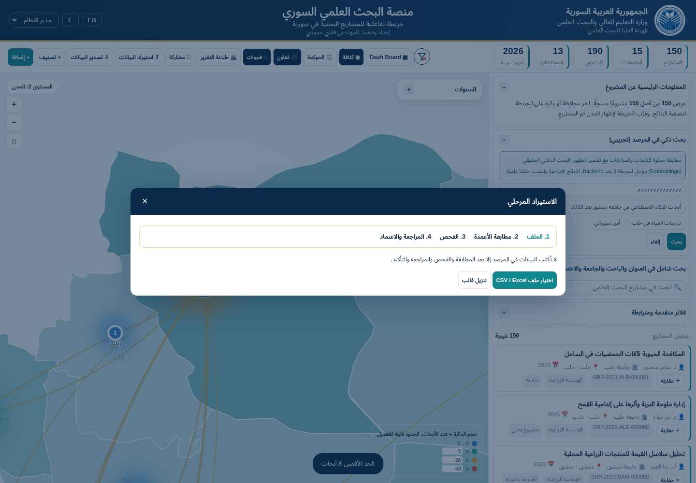
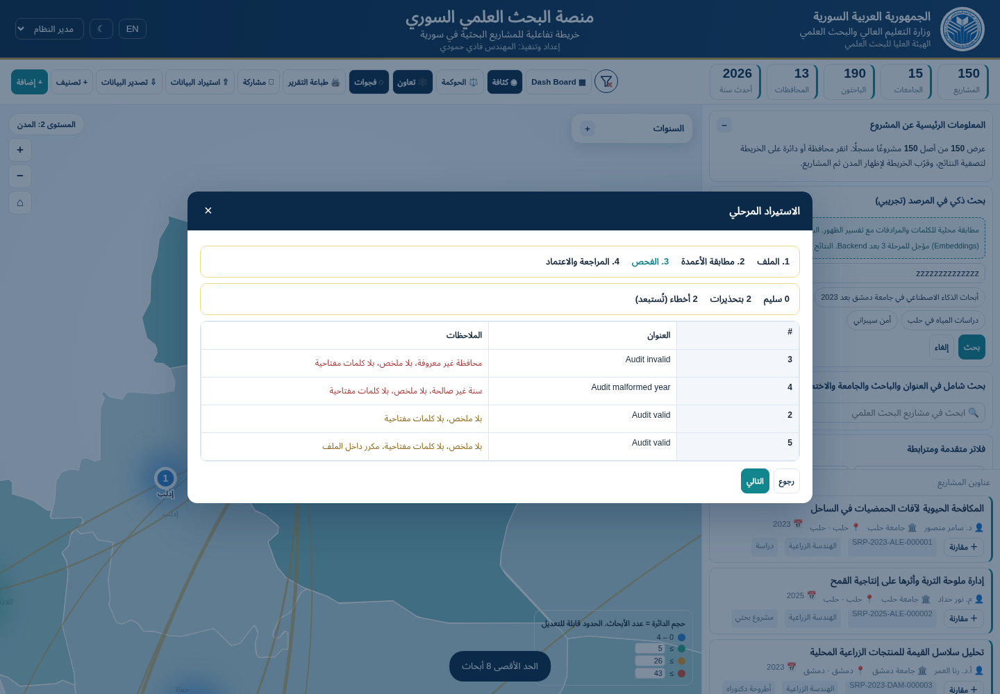
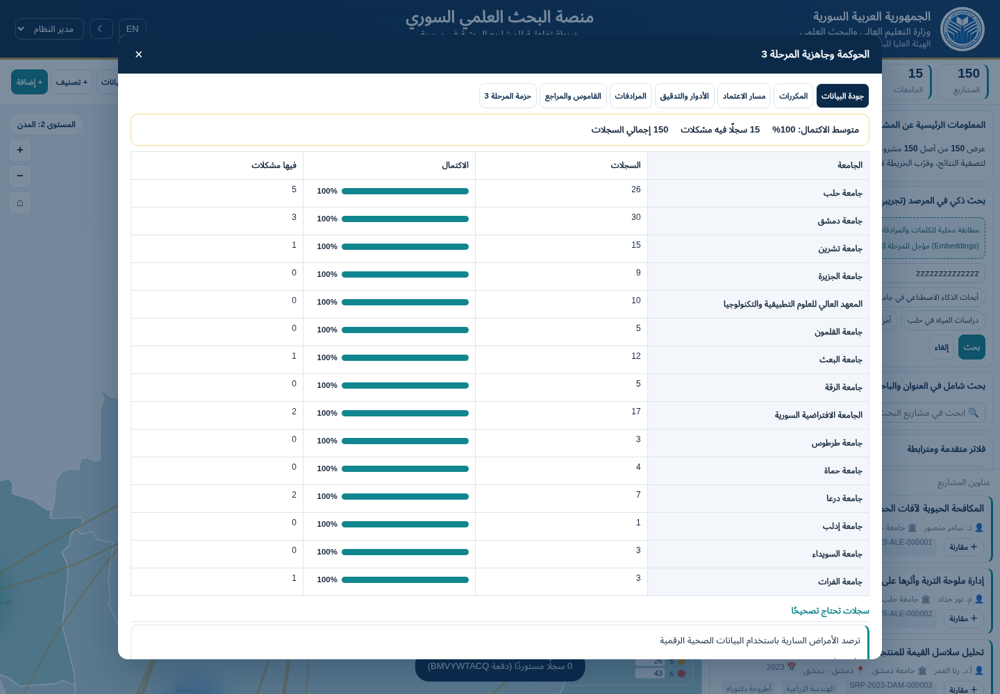
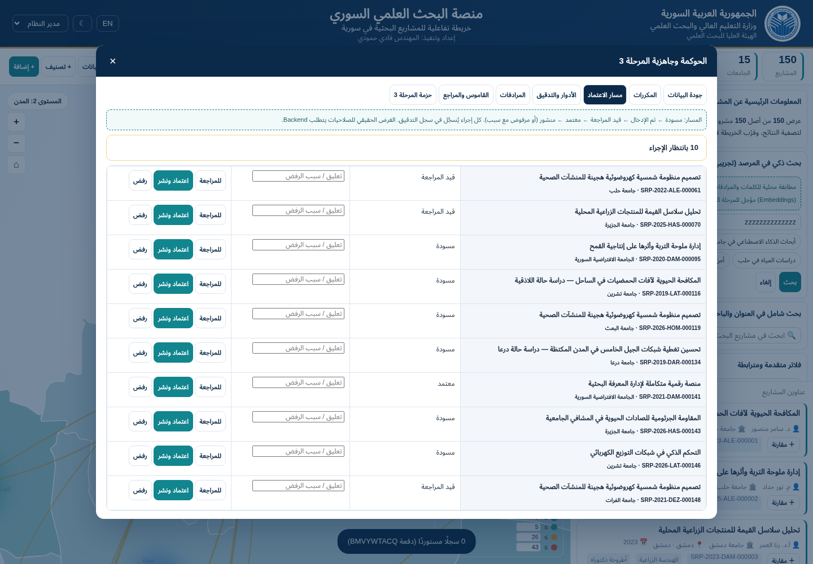
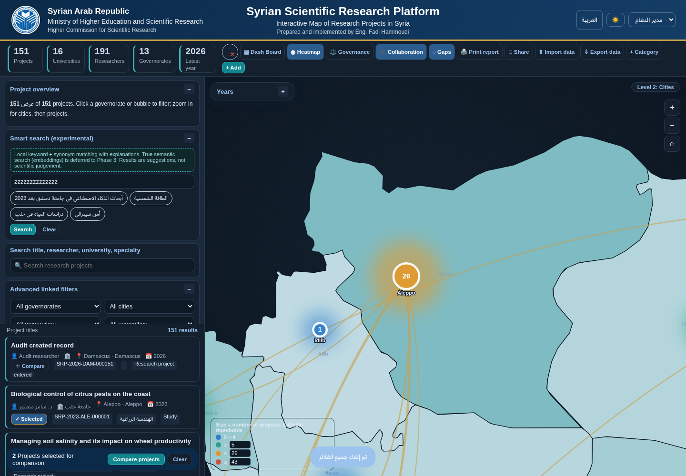

# 08 — Audit evidence and validation limits

Audit date: 2 November 2026. This is evidence from the **supplied original prototype**, not screens designed for the new platform. Source references in the [inventory](01-feature-inventory.md) remain authoritative for behavior. See the [traceability matrix](07-functional-traceability-matrix.md) for all 48 audited feature groups.

## Method and reproducibility

- Inspected original HTML structure, inline CSS, all script sections, handlers, generated controls, reference/seed data, storage and URL state; read the DOCX's paragraphs and tables via Word XML extraction. Source copies and SHA-256 hashes are recorded in [document 06](06-open-questions-and-assumptions.md).
- No cloud-browser connector or Browser skill was available in this session. Used installed Playwright with local `/usr/bin/chromium` for supplemental evidence. The Product Design audit's screenshot evidence format was applied; unavailable user-context/override reference resources could not be read. The user-requested source/architecture audit remains the primary method, rather than claiming completion of that plugin's full browser workflow.
- Served unchanged HTML over `127.0.0.1:8765`, used a fresh isolated browser context at 1440×1000, then 390×844. Blocked **remote** requests to make an explicit offline baseline: the optional Excel CDN and external font were not loaded. Bundled logo and browser font fallback rendered. Never disabled TLS verification or changed attachment code.
- [Harness](evidence/runtime-audit.cjs) contains the exact sequence. It uses both UI actions and named direct calls into original functions; direct probes are not proof of UI reachability, policy enforcement or keyboard operability. Synthetic mutations were confined to that disposable browser context. No project data service, backend or application was implemented.
- [Raw results](evidence/runtime-results.json): 27 diagnostic observations completed; no uncaught page exceptions in that sequence. This is **not** a 27-test passing acceptance suite: several observations deliberately reproduce defects. Successful execution is distinct from correct product behavior.
- Reproduce with Python's HTTP server rooted at `docs/sources` on the port above, then `node docs/evidence/runtime-audit.cjs` with Playwright and Chromium available. The harness opens only the local supplied prototype and closes its browser. No dependency installation is implied by this documentation.

## Numbered captured steps

Screenshots were opened and inspected during the audit. They capture the visible viewport/content state; internally scrolling tables and dialogs continue beyond the visible area. They are not asserted to expose every hidden item. Normal page cropping, where original panels scroll, is an observed layout limitation rather than evidence of missing data.

### 1. Geographic Explorer baseline — functional with interpretation risks

The first-run demo is Arabic/RTL and defaults to admin. It creates 150 synthetic records: 140 published, six draft, three review and one approved. Reference data contains 14 governorates, 22 cities and 15 university-list entries. These are **prototype fixture counts**, not official Syrian statistics. Baseline map/KPIs/list agree on 150; only 13 governorates have seeded records. The crowded toolbar mixes public discovery with operations; task-based navigation is justified by this evidence. Map area and list are functional, but sample-data and role limitations need prominent explanation.

### 2. Record detail — functional local metadata with accessibility/visibility risks

Detail shows bilingual title, registration ID, metadata, abstract, keywords, related records and further content in the scrolling dialog. Lower audit/action sections are source-inspected, not all visible in this frame. At deep zoom a dot handler opens the detail; the first dot was off-viewport, so the harness dispatched its click event rather than proving pointer reachability. Dots have no keyboard activation handler in the original. Native dialog gives a useful modal base; replacing all dialog content on nested navigation loses context. A separately probed retained comparison exposes an unpublished record after switching to viewer because visibility is not rechecked.

### 3. Insights overlay — working aggregation/drill with presentation and meaning risks

The dashboard generated eight panels, 47 year/bar drill targets and 98 matrix data/row-label cells in this baseline (counts of controls, not new product metrics). Selecting year 2019 produced 20 results and closed the overlay. The timeline is above the visible distribution region with a compressed/scrolling panel; this screenshot does not establish full timeline readability. Top-N truncation and internal scrolling obscure values. The red zero cells cannot establish national research absence. Matrix cells and governorate comparison rows are read-only in source. Charts lack keyboard control semantics/table parity.

### 4. Research comparison — working bounds; light-theme differences are poorly communicated

Two selections open a side-by-side matrix across the existing 12 fields. The header reports seven differing fields for these two records. A separate probe attempted nine selections and retained eight with a limit toast. The source marks differing rows but contains invalid light-theme background CSS (`var(--card)3bf`); yellow highlighting promised in copy is not reliably rendered here. Difference cues must include text and valid theme tokens. Wide comparisons need their own labeled scrolling region and sticky context.

### 5. Import entry — functional four-step local workflow, Excel unverified

Entry exposes file selection and template download and promises no catalog write before confirmation. Source supports saved-stage resume/discard. This frame does not prove upload parsing: the next validation probe injected rows through the original `stageFile()` function. Excel cannot be asserted working in the offline capture because the external parser was intentionally unavailable; source includes an unavailable-library notice and CSV alternative.

### 6. Import validation — functioning diagnostics with weak validation policy

Four injected rows yielded two warnings-only rows and two error rows. An unknown governorate and malformed year were errors; missing abstract/keywords and within-file duplicate were warnings. Committing with warnings excluded imported **zero**, cleared staging and reported zero imported. This verifies the exclusion branch, not a successful real CSV/XLSX upload/commit. Source inspection confirms eligible rows are appended on confirmation. No transaction service, rollback, idempotency or immutable batch history exists. A zero-import success should be explained before discarding the recoverable stage.

### 7. Governance quality — functioning presence score with important limits

This all-records report shows 100% required-field presence alongside 15 records with other issues. That is consistent with two different formulas, not necessarily a contradiction. It must never be labeled scientific quality, verified source quality or reporting coverage. Initial issue links show only the first 30; duplicate UI similarly limits display to 40 pairs. Seven governance tabs expose existing supporting functionality, not a reason to put all administration in the map toolbar.

### 8. Review queue — working local mutations, simulated governance

Ten nonpublished baseline records appear. Rejection without a reason retained status and displayed the reason requirement. Approve/publish changed a review record directly to published, bypassing a separate approved step. Source offers the same direct action for every nonpublished row; it does not implement its narrated ordered lifecycle. Dates, actor and audit are local role/action strings, not verified identities or institutional approval. No formal workflow policy is inferred.

### 9. English and dark theme — functional switches with incomplete localization

Document `lang=en`, `dir=ltr` and dark mode changed correctly. Role option labels remained Arabic; smart-search examples, some metadata and text fragments also remain Arabic. Research content language fallback is legitimate; incomplete interface translations are defects. The locally created audit record makes later counts 151; the blank university value causes the original distinct-university KPI to count an empty value as an additional “university.” Do not read the later frame as the unchanged baseline. Semantic tokens must replace invalid/hard-coded colors and distinguish missing values from contributing institutions.

### 10. Narrow viewport — responsive stacking works, primary tasks become distant

The page reflows with document width 390px and map width 390px; the KPI strip scrolls independently. The complete page screenshot reveals that the map follows a tall filter/results area, separating spatial controls from discovery. Repeated nested scrolling, a floating comparison tray and dense actions create reachability risks. Reorganizing existing tasks into one primary content mode on small screens addresses this without adding capabilities. The frame does not prove touch gestures or full mobile accessibility.

## Additional observations from the diagnostic run

| Observation | Result and implication |
|---|---|
| Researcher filter | `IMPOSSIBLE_RESEARCHER` retained 150 results; `F.res` is never read in `match`. Visible control is incomplete |
| Positive text query | `شمسي` produced 12 results, 12 displayed cards, KPI 12 and matching query hash |
| Linked governorate | `DAM` produced 57 records, all with that governorate; city options narrowed to Damascus |
| Map levels and overlays | Level 2 grouped into 13 populated city nodes; level 3 generated 88 dots across clusters; density/gaps/collaboration toggled and threshold edit changed `TH` |
| Cluster summary/show projects | Aleppo summary showed 26; applying it set `gov=ALE`, count 26 and zoom 2.6 |
| Smart search | `الطاقة الشمسية` produced 29 local candidates with score/reason; unmatched input reset `SM=null` and returned all 150 ordinary records while saying no matches |
| Visibility leak | Retained nonpublished record appeared in viewer comparison; list itself obeyed published-only visibility |
| Custom definition type | A declared `number` field rendered input `type=text`; metadata does not establish typed behavior |
| Create/save | Empty title/researcher blocked save; completing those fields created local record 151 with generated ID, `entered` status and audit. Correct `srm2_projects` storage key was present |
| Export | CSV produced `research-projects.csv`; requesting XLSX without library also produced CSV. File-download occurrence was checked; spreadsheet content round-trip was not |
| Browser history | After Back changed hash to earlier query, `F.q` remained the later query. Initial hash hydration exists; live hash/history handling does not |

## Not verified at runtime

Live CDN/fonts/Excel support; actual file chooser/parser success and full import commit; template/audit/permission/synonym/reference/SQL/project artifact contents; profile every branch; editor mutations on every field; synonym/reset/reference persistence; clipboard success and rejection; print dialog or printed output; reload persistence/migration/storage-quota failures; malformed file security; multi-browser behavior; keyboard-only complete tasks; screen-reader output; computed contrast; 200%/400% zoom; official map accuracy/rights; real authorization/server/database behavior. Source-level coverage of the associated handlers is in the inventory and matrix. These remain later validation requirements, not silently passed checks.

No national statistics, PRD-only backend mechanisms or policy decisions were validated by the audit. The evidence supports a Phase 1 implementation blueprint and its identified risks; it does not certify the original prototype or a future production system.
