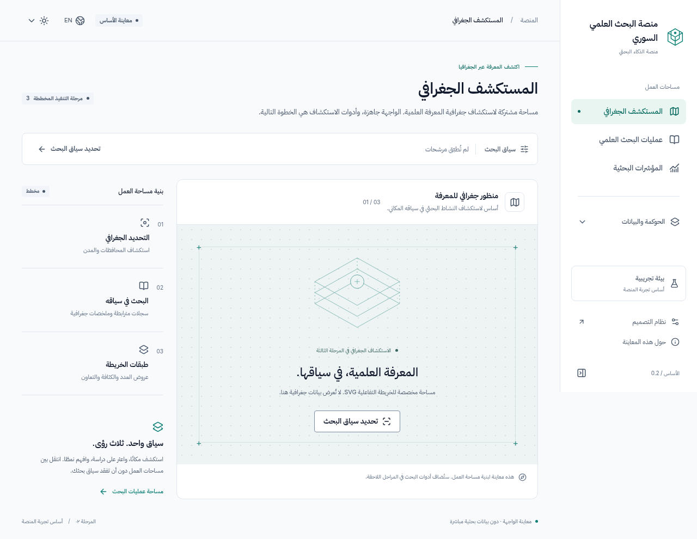
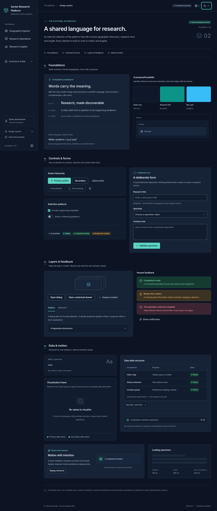

# Phase 2 — Implementation report

Completed 2 November 2026. **The frontend foundation is implemented and runnable. Phase 3 has not started.**

## Launch and review

From the repository root:

```bash
npm ci
npm run dev
```

Open port **5173** through your development environment's port forwarding, or `http://localhost:5173` when running locally. Start at `/explorer`, then open `/dev/design-system` to inspect and interact with the complete internal component showcase. Header controls switch Arabic/English and light/dark/system appearance. The development server was started and exercised in this workspace; a later session must start it again rather than assuming processes survive.

The production bundle is generated by `npm run build` and can be checked with `npm run preview` on port 4173. It was also exercised in Chromium. The internal showcase and its navigation link are absent from that build; a direct production request to `/dev/design-system` renders the application's unavailable-page state. No environment publication or deployment was performed.

## Implemented scope

| Area | Working foundation | Deliberate boundary |
|---|---|---|
| React application | React + strict TypeScript + Vite; React Router, bootstrap/error boundary, reproducible lockfile and CI configuration | No server, database or authentication |
| Shell and navigation | New identity mark, collapsible desktop rail, mobile navigation drawer, active states, primary workspaces and supporting route hierarchy | Supporting destinations are clearly labeled structural previews, not operational commands |
| Three primary views | Explorer, Research Operations and Insights each have a real address and contextual orientation | No complete map, result list, comparison, analytics or editor |
| Shared query | Canonical URL codec, query-context drawer/chips, validated governorate selection, text, clear/remove, Back/Forward/reload and legacy hash migration | It demonstrates state continuity; no research search is presented as running |
| Themes | Light/dark/system, independent semantic palettes, pre-paint preference bootstrap and render-blocking theme CSS, guarded explicit preference persistence | Browser-local preferences, not an account setting |
| Localization | Arabic default, English LTR, centralized stable messages, direction-aware controls/panels, bundled IBM Plex Sans Arabic/Inter, `Intl` formatters | No fabricated research translations or official numeral policy |
| Design system | Actions, labeled form controls, selections, tabs, tooltip/popover, dialog/drawer, disclosure, feedback/toasts, empty/loading states, layouts and data primitives | Tables have no invented sorting; empty chart/metric/comparison specimens are not product workflows |
| Motion | Reusable region entrance, layer transitions, rail/disclosure/control feedback, theme transition and reduced-motion override | Map/chart durations are conventions only; no actual geographic/chart animation |
| Domain/data seams | Typed source adapter, deterministic original seed/reference/geometry/synonym fixtures, query/filter/visibility functions, SVG renderer contracts, guarded versioned snapshot repository | Original synthetic data remains development/test material; no current app record mutation or real permission guarantee |
| Internal showcase | Interactive specimens for validation, dialog/drawer/popover, tabs, disclosure, selections, chips, notifications, loading and motion replay | Development-only; no fake statistics or working-looking research charts |

Source attachments remain unchanged; their original SHA-256 values still match Phase 1. The [traceability matrix](07-functional-traceability-matrix.md) retains all 48 feature groups and now includes a Phase 2 delivery annotation. Partial foundation work does not mark complete feature workflows finished.

## Major design and UX decisions

1. **A research workspace rather than an administrative dashboard.** Fine boundaries, compact controls, deliberate whitespace, a geometric identity and restrained teal establish visual order without ministry logos, dense global toolbars or invented metrics. The original HTML layout was not retained.
2. **Stable primary navigation; progressive supporting navigation.** The rail keeps the three research perspectives visible. Existing governance/data destinations sit in a disclosure group. Collapsing the rail saves analytical space; below 960px a modal drawer gives readable labels and touch-sized interaction instead of squeezing desktop navigation.
3. **One query with separate presentation preferences.** Navigating between perspectives preserves URL context. Locale/theme and disclosure state do not redefine research identity. A concrete race found in testing—rapid text and facet updates discarding text—was repaired with queued command composition while URL state remains the render authority.
4. **Honest structural views.** Reserved canvases explain the delivery phase. The spatial artwork is decorative, not a fabricated Syria map or geographic result. All statistical specimens are empty or describe components themselves.
5. **Arabic as the native presentation.** IBM Plex Sans Arabic provides readable scientific text and labels; Inter complements Latin content. Logical properties and direction-aware overlays replace mirrored hard-coded layouts. Original names/content are not translated on assumption.
6. **One semantic palette per mode.** Identity teal is retained as a reference; the light action teal is darker for readable white text. Dark actions use lighter teal with dark foreground. Muted text and control boundaries were strengthened after contrast review. Dark mode has its own surface hierarchy rather than inversion.
7. **Motion explains context.** Short fade/translate transitions, predictable logical panel placement and reduced-motion behavior preserve orientation without animated numbers, bouncing controls or decorative chart activity.

See [design-system documentation](07-design-system.md) and [motion conventions](08-motion-and-interactions.md) for actual APIs/tokens and extension rules.

## Technical architecture and documented adjustments

- `app/` owns composition, route declarations, the shell and navigation registry. `shared/ui/` owns interface patterns; `features/` composes them. Query/domain/data logic remains outside presentation. The structural workspace component can be replaced by independent feature modules without changing query contracts or shell controls.
- URL parameters are the query authority. Typed reducers/codecs support the existing scalar facets, multi-year/range intersection and custom-category equality. The researcher predicate is repaired at the domain layer with tests; its complete UI remains Phase 4.
- React contexts cover the modest current shell/preferences needs. Zustand is deferred until substantial transient cross-workspace state exists; this avoids introducing a second filter authority. React Hook Form and spreadsheet parsers likewise wait for the phases that actually implement authoring/import.
- Styles use **namespaced CSS** rather than CSS Modules. Module ownership and semantic tokens provide isolation without building another styling abstraction. No component owns a private light/dark palette.
- Role values and visibility helpers are explicitly demo infrastructure. Lookup rechecks visibility, but anyone who controls this frontend can change its code/data. There is no production authorization boundary, authenticated actor or institutional scope.
- The snapshot persistence adapter validates schema versions, records and IDs, and reports corrupt/denied/quota failures without silently seeding over saved data. Its low-level snapshot save is infrastructure, not an implemented record editor/import command. Recovery migrations and workflow UI are deferred.
- Only lightweight reference labels enter the shell bundle. Research fixtures, full geometry and schema adapters are isolated for later consumers/tests. Fonts are bundled locally with their license texts under `public/licenses`; no runtime font or map CDN is required.
- The Phase 2 brief explicitly authorizes system appearance and direct implementation from the supplied design direction. These supersede the earlier light/dark-only baseline and any inferred need for another visual-selection checkpoint. PRD-only research features remain excluded.

## Scalability

New workspaces register routes/navigation and compose existing primitives. New filter dimensions extend typed query/predicate/serialization contracts; they do not introduce independent filtering in a map/chart component. Additional reference categories and record fields enter the adapter/domain layer, with validation and migration decisions. Chart/map renderers receive derived inputs and emit typed intents. Replacing local storage with real APIs later occurs behind the repository boundary; authorization, database transactions, institutional policy and immutable audit must then be implemented server-side. None is simulated as complete here.

## Executed validation

All results below are from this workspace, not a claimed new cloud snapshot or CI run.

| Check | Result and evidence |
|---|---|
| Frozen installation | `npm ci` succeeded with the committed exact dependency lockfile; Node 24.19.0 / npm 11.9.0 |
| Production build | `npm run build` passed, including strict TypeScript; [build log](evidence/phase-2/build.log). Main JS about 455 kB / 147 kB gzip; CSS about 38 kB / 8 kB gzip; no large-chunk warning after removing eager fixture imports |
| TypeScript | `npm run typecheck` passed |
| Unit/component/integration | **41 passed, 0 failed, 0 skipped** across five files: domain 13, data 8, components 10, preferences 6, query navigation 4. [Machine-readable results](evidence/phase-2/unit-results.json) |
| Browser suite | **15 passed, 0 failed, 0 skipped, 0 flaky** in Chromium. [Results](evidence/phase-2/browser-results.json) |
| Automated accessibility | **10 stable-state axe scans, 0 reported violations**: shell/showcase in Arabic and English, light/dark; plus open dialog in both themes. [Scan results](evidence/phase-2/accessibility-results.json). This is not full WCAG certification |
| Responsive behavior | Browser checks at **390, 768, 1280 and 1920px**: no unintended document horizontal overflow; mobile menu and desktop rail work; showcase reflows. Additional visual captures at 1440px |
| Interaction checks | Route changes; query refresh/history/removal; rapid query updates; theme/system/persistence; locale round-trip; form validation; checkbox/switch; tabs/disclosure/popover/toast; dialog/drawer focus containment, Escape and restoration; RTL/LTR drawer side; reduced motion; unknown-route recovery; prototype link migration |
| Runtime diagnostics | Final browser suite asserts no page exceptions or console errors across its tested flows |
| Production smoke | Built Explorer rendered, development link absent, internal gallery route excluded, no runtime errors. [Result](evidence/phase-2/production-smoke.json) |
| Formatting | `npm run format:check` passed |
| Source/scope integrity | Original attachments unchanged; 48 inventory/matrix capability rows retained; no backend calls or fabricated research statistics added |

The clean dependency install required restarting the already-running Vite optimizer; this was a development-server cache issue, not a missing dependency. Early interaction/contrast failures were investigated and corrected. Screenshot/accessibility helpers now await lazy content, fonts and finite transitions, then capture modal viewports rather than misleading full-page overlay composites. Assertions were not disabled to obtain passing results. The CI workflow is supplied but has **not** been run on GitHub in this task.

## Visual evidence

The screenshots below were opened and inspected. They show the actual running implementation, not generated mockups. Full-page gallery captures show the component collection; modal captures use the viewport so fixed overlays remain understandable.

| Evidence | What to review |
|---|---|
| [Arabic light Explorer](evidence/phase-2/01-explorer-ar-light.png) | Rail, hierarchy, shared context, structural canvas and explicit scope |
| [Arabic light showcase](evidence/phase-2/02-showcase-ar-light.png) | Typography, surfaces, controls, feedback and empty data primitives |
| [English dark Explorer](evidence/phase-2/03-explorer-en-dark.png) / [Arabic dark Explorer](evidence/phase-2/04-explorer-ar-dark.png) | Theme hierarchy, direction and preserved query |
| [English dialog](evidence/phase-2/05-showcase-dialog-en.png) / [Arabic drawer](evidence/phase-2/06-showcase-drawer-ar.png) | Legibility, focus, logical side, overlay separation and footer access |
| [English dark showcase](evidence/phase-2/07-showcase-en-dark.png) | Complete dark-mode component treatment |
| [Arabic dark mobile](evidence/phase-2/08-mobile-ar-dark.png) / [mobile navigation](evidence/phase-2/09-mobile-navigation-ar.png) | Reflow, mobile navigation and long Arabic labels |
| [390px](evidence/phase-2/responsive-390-en-light.png), [768px](evidence/phase-2/responsive-768-en-light.png), [1280px](evidence/phase-2/responsive-1280-en-light.png), [1920px](evidence/phase-2/responsive-1920-en-light.png) | Representative mobile, tablet, laptop and wide layouts |





Reproduce the browser suite with `npm run test:e2e`. Additional showcase/mobile captures and production smoke use `node scripts/preview-evidence.cjs` with dev port 5173 and production preview port 4173 running. Those scripts exercise local application instances only; they do not publish anything.

## Incomplete items and limits

- Full Explorer, search/results/detail/profiles/comparison/editor, dashboards, import/export, governance commands and reference administration remain intentionally unimplemented. Structural routes and component specimens do not replace them.
- Chromium was tested. Firefox/WebKit, full manual screen-reader sessions, actual 200%/400% browser zoom, real mobile hardware/soft-keyboard behavior and a user usability study were not performed. Narrow viewport tests are not a claim that those checks passed.
- Automated axe tests cover rendered stable states, not every possible future screen or interaction. New combinations still require contrast/focus checks; official accessibility sign-off remains open.
- Snapshot persistence has no multi-user concurrency, server backup or automatic migration/recovery UI. Legacy hash filters migrate, but original `srm2_` browser-edited research data is not automatically copied into the new repository; no user data is silently overwritten.
- Official brand endorsement, map licensing/accuracy, data rights, institutional authority, public-field policy and formal workflow rules remain the Phase 1 open decisions. No invented resolution is embedded in the application.
- No real APIs, database, research identity resolution, trained semantic search, institution-sector layers or new PRD-only analytics are implemented.

## Readiness for Phase 3

The foundation supports beginning the **Geographic Research Explorer** on a new instruction: renderer/geometry contracts, exact demo fixtures, query/visibility selectors, theme-aware geographic tokens, reusable panels, localization, motion conventions and test infrastructure are available. Replace only the structural Explorer canvas with its feature module; keep URL state outside SVG internals and preserve honest count/coordinate/sample-data labels. Record detail integration still follows the Phase 3/4 contract in the roadmap.

**Phase 2 is complete. Stop here; do not begin Phase 3 automatically.**
