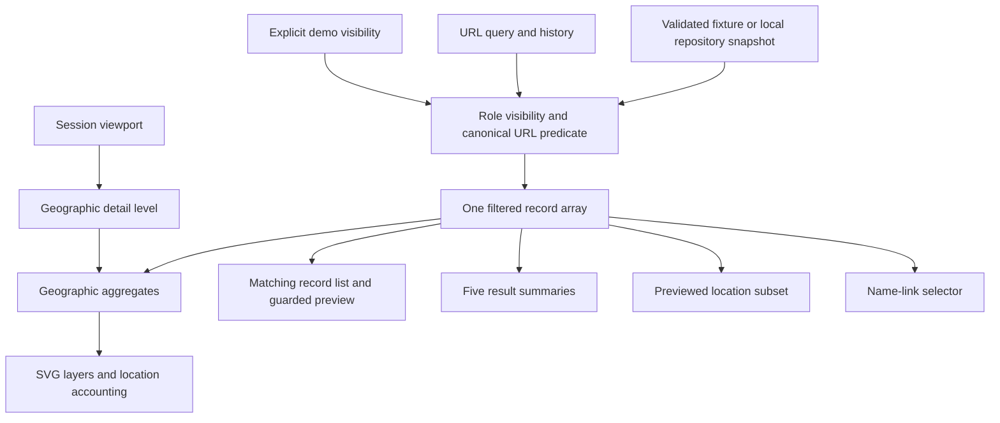

# Geographic Explorer architecture — Phase 3

Status: implementation in `/explorer`. Read with the [interaction specification](11-geographic-interaction-specification.md), [implementation report](12-phase-3-implementation-report.md), and [functional traceability matrix](07-functional-traceability-matrix.md). The original HTML remains the scope authority; Phase 1 documents remain the audit baseline.

## Scope and source fidelity

The complete map module implements **F17–F23 and the map portion of F24**. Shared discovery used by this workspace covers ordinary search/facets/year/category controls, chips, query sharing, map-linked record results and five summaries (F06–F13, F15–F16). F01–F05/F48 apply across the experience. F20 opens a guarded, explicitly limited read-only preview; full F25 detail, related records, profiles, comparison and authoring remain Phase 4. Assisted search F14 is not implemented here.

Sources are `docs/sources/syria-research-observatory_v2_prototype.html`, its original functions `nodes`, `renderMap`, `showInfo`, `zoom`, `collabLinks`, `collabDraw`, `match`, `buildSel`, `upd`, and the original deterministic fixtures extracted in Phase 2. Geometry remains the **14 original SVG paths**, with **22 supplied city references**, **15 institution references** and **150 synthetic records**. These are reference/fixture counts, not national totals. No basemap, coordinates, boundaries, research records or policy guidance have been added. Source extraction verifies SHA-256 `3ec5d7338ce583e643ec3d1c7fec0566a0238959abcd451e42a29af9c88da44c`.

## Module responsibilities

| Location | Responsibility |
|---|---|
| `src/app/App.tsx` | Lazy Explorer route; session provider above route transitions; existing shell and routes retained. |
| `src/domain/geography/models.ts` | Geographic reference, projection, viewport and renderer intent contracts. No UI state. |
| `src/domain/geography/aggregation.ts` | Governorate/city grouping, usable-location accounting, three detail levels, deterministic collision layout, threshold classes, sampled dots and inferred name links. |
| `src/domain/geography/viewport.ts` | Pure pan/zoom/reset and viewport membership calculations. |
| `src/data/demo/` | Preserved geometry, dictionaries, provenance and synthetic source data. |
| `src/data/contracts/` and `src/data/local/` | Existing typed repository, validated snapshots and storage errors. No API or backend. |
| `features/explorer/ExplorerPage.tsx` | Workspace composition and user intents; derives every consumer from one filtered record set. |
| `features/explorer/state/ExplorerSession.tsx` | Viewport, map layers, manual thresholds and explicitly simulated visibility. |
| `features/explorer/hooks/useResearchSnapshot.ts` | Loading/ready/error repository lifecycle, retry and cross-tab snapshot invalidation. |
| `features/explorer/hooks/useMapViewport.ts` | Resize/motion preference observation, screen-to-world transform and cancellable SVG viewport animation. |
| `features/explorer/hooks/useMapGestures.ts` | Pointer capture, drag suppression and nonpassive pointer-centered wheel zoom. |
| `features/explorer/components/MapCanvas.tsx` | SVG/control composition and keyboard viewport commands. |
| `features/explorer/components/MapLayers.tsx` | Independently rendered boundaries, labels, heat, name links, bubbles and sample markers. |
| `features/explorer/components/ExplorerFilters.tsx` | URL-bound linked facets and years; validated range draft; category/value controls. |
| `features/explorer/components/LocationContext.tsx` | Context for a previewed location: current count, top-three name counts, available cities and explicit drill actions. |
| `features/explorer/components/MapRecords.tsx` | Matching records in batches of 25; guarded read-only preview, keyword handoff and safe external links. |
| `features/explorer/components/VisualizationSettings.tsx` | Layer explanations, accessible legend, threshold validation, inferred-link table and demo visibility. |
| `src/shared/query/` | Sole query authority: URL parsing, atomic multi-field updates, dependent filter reconciliation and chips. |
| `src/shared/tokens/tokens.css`, `src/shared/i18n/explorer.ts` | Semantic map colors/motion, bilingual UI strings. |

## Data and state pipeline

The canonical query has `q/gov/city/uni/spec/branch/yr/yf/yt/res/type/kw/cat/catv`. The renderer never maintains a second filter object. Text terms combine with AND; selected years combine with OR, then intersect with all other constraints and inclusive year bounds. Self-excluded facets preserve the current selected value even when it has no matches. Category filtering is exact equality; the six supplied definitions are available. Creation/persistence of custom definitions and reference additions belongs to Phase 6; arbitrary existing custom record values remain supported by the domain predicate.

`setFilters` commits compound geographic and range changes atomically. A governorate change reconciles an incompatible city. Chips and reset operate through the same codec. Navigation links preserve `location.search`; Back/Forward, refresh and copied queries hydrate the same controls. The full filter panel replaces the foundation-only context drawer entry within Explorer, while the shell context remains reusable elsewhere.

| State | Lifetime / sharing |
|---|---|
| Ordinary query | URL; navigation, history, refresh and copied link. |
| Viewport, layers, manual thresholds | In-memory session provider; survive switching workspaces, reset on reload. Not encoded in shared URLs. |
| Demo role | Guarded browser preference `snrp.demo-role.v1`; defaults to viewer; not in URL. |
| Theme/locale | Existing `snrp.preferences`; initialization before first paint. |
| Previewed location, map/list presentation, open record and panels | Workspace-local transient UI. Query geographic context hydrates on entry. |
| Range/threshold field drafts | Panel-local until validated apply; other filters are live. |
| Data | Existing versioned `snrp.snapshot.v1` or exact fixture when no saved snapshot exists. |

## Geographic model and data integrity

Projection is unchanged: `x=(longitude−lon0)×c×k`, `y=(lat1−latitude)×k`. SVG coordinates remain physical and never mirror with RTL. Names and identifiers come from supplied references; translated UI labels do not change stored Arabic city/institution values.

At national level, records with a known governorate and finite reference coordinate can be grouped there. At city/record level, the record must also match a supplied city **in that governorate** with finite coordinates. A missing/unrecognized city stays unplotted at those levels instead of silently inheriting the governorate coordinate. Unknown governorates stay unplotted at every level. The complete matching list retains those records, and the workspace reports unlocated counts. Location-context city incompleteness is also explicit.

A ready, empty query is an observed zero **within this sample**. A failed/loading repository is not an empty record array for presentation: map shapes use unavailable patterns, counts display `—`, and no synthetic zero-count chart or stale markers appear. A corrupt/unsupported saved snapshot is never replaced automatically. Retry re-reads it; deliberate data-recovery tools remain later work.

Default viewer visibility yields 140 published fixture records; explicitly selecting another simulated role yields all 150. Every map count, list, context and record preview passes through the same visibility predicate. This repairs the prototype's unpublished-detail leakage **within the demo UX**; the JavaScript bundle still contains the synthetic fixture and is not a security boundary.

## Rendering and motion

The source viewport starts at `−20 −20 1040 958`. Zoom ratio is `1040 / width`, with governorates `<2`, cities `2–<4.5`, and illustrated records `≥4.5`. Width clamps to `40–1040`; panning is intentionally unbounded like the source, with a permanent reset control and Home equivalent. Screen-to-SVG conversion uses the inverse screen CTM, correcting pointer anchoring in letterboxed maps.

Bubbles retain source square-root relative sizing and 120-pass pairwise collision relaxation, scaled to screen pixels. A deterministic zero-distance separation repairs coincident anchors. Leaders retain the true supplied reference anchor. The record ring shows at most the first 12 records per city, disclosed as illustrations rather than research coordinates. All filtered records are available in the list.

Map animation updates only the SVG `viewBox` with a cancellable requestAnimationFrame loop over the shared `--motion-map` duration (380 ms); React does not rerender the domain tree each animation frame. Dragging updates directly without easing. Selection/theme colors use shared transitions; marker/layer reveals use opacity. Reduced motion performs final viewport updates immediately. Panels use existing Radix focus/dismissal behavior and direction-aware CSS; mobile context enters vertically.

## Visualization contracts

- Count classes use three validated ascending positive integer thresholds. Automatic thresholds preserve the source's 20%/45%/75% heuristic and minimums 2/3/4. Color never changes counts.
- Concentration is blurred aggregate counts at reference anchors, not kernel density, research-site intensity or statistical estimation.
- Distribution shades positive governorate counts relative to the current maximum. Zero matches use hatching; unavailable data use dots. Reporting coverage remains unknown for all governorates. No record absence is interpreted as research absence.
- Shared-name links use the source Arabic normalization/title stripping and university sets per name string. Known distinct reference-city anchors only, distance >8 SVG units, up to 15 highest-weight pairs. This is not verified coauthorship or identity. A table provides the text alternative. Institution pins and campus coordinates are not inferred.

## Maintainability and later integration

No new runtime dependency was needed. Pure selectors and a repository boundary let Phase 4 reuse identical queries/IDs and replace the limited preview with full record context without changing SVG internals. Components receive records/selections/callbacks rather than reading global prototype variables. Map colors are separate semantic tokens in each theme. Ordinary query and locale changes do not rebuild geographic references or translate data.

For larger datasets, move indexing, aggregation and expensive collision/name matching into memoized workers or API adapters, then add bounded rendering and list virtualization. The current O(n²) collision loop is appropriate to 14 governorates/22 cities; it is not a claim of large-scale GIS performance. No workers, server aggregation, API, database, real permissions, official coverage or new geographic hierarchy are implemented now.
